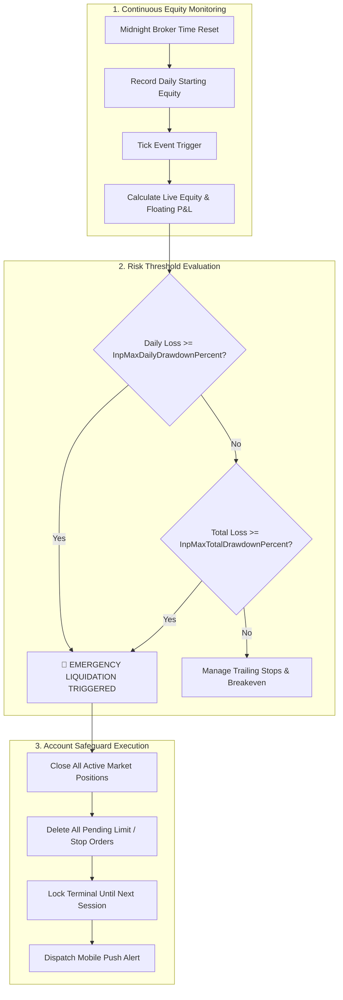

# 🛡️ Prop Firm Automated Risk Guardian & Equity Drawdown Protector (MT5 / MQL5)

[](https://www.mql5.com)
[](https://www.metatrader5.com)
[](https://ftmo.com)
[](https://opensource.org/licenses/MIT)

> An institutional-grade automated risk manager and equity protection Expert Advisor (EA) engineered for **MetaTrader 5 (MT5)**. Designed specifically for traders navigating funded account challenges (**FTMO, FundedNext, Apex, Funded Trading Plus**) to eliminate catastrophic account breaches by enforcing hardcoded daily loss limits, maximum total drawdowns, and automated trailing stops.

---

### 💼 Need Custom Expert Advisors, Prop Firm Passers, or Algorithmic MQL5 Tools?
I engineer custom quantitative trading algorithms, MT4/MT5 Expert Advisors, and proprietary execution bridges for private funds and retail prop traders.
* 💬 **Telegram:** [@JanzebBlockdev](https://t.me/JanzebBlockdev)
* 💼 **Fiverr Profile:** [Verified Quantitative Developer (Fiverr)](https://www.fiverr.com/jahanzaib313110)

---

## 📑 Table of Contents
1. [Why Most Traders Fail Prop Firm Challenges](#-why-most-traders-fail-prop-firm-challenges)
2. [Dual GUI Interface (On-Chart HUD & Desktop App)](#-dual-gui-interface-on-chart-hud--desktop-app)
3. [Core Protection Features](#-core-protection-features)
4. [Drawdown Protection Flow](#-drawdown-protection-flow)
5. [Input Parameters & Configuration](#-input-parameters--configuration)
6. [Installation & Terminal Setup](#-installation--terminal-setup)
7. [Disclaimer](#-disclaimer)

---

## 🖥️ Dual GUI Interface (On-Chart HUD & Desktop App)

The suite provides two real-time monitoring interfaces to keep your funded account safe:

### 1. Native MT5 On-Chart HUD Dashboard
Directly embedded inside `RiskGuardian.mq5`. Renders an interactive glassmorphic HUD panel in the upper corner of your MT5 chart:
```text
┌──────────────────────────────────────────────┐
│  🛡️ RISK GUARDIAN PRO                       │
├──────────────────────────────────────────────┤
│  Live Equity:      $101,420.50               │
│  Daily P&L:        +$1,420.50 (+1.42%)       │
│  Loss Buffer:      $5,420.50 Remaining      │
│  Status:           🟢 SAFE THRESHOLD         │
│                                              │
│  [ 🚨 CLOSE ALL TRADES (1-Click Panic) ]    │
└──────────────────────────────────────────────┘
```

### 2. Standalone Desktop GUI Monitor (`monitor_gui.py`)
A Python Tkinter desktop application that displays live account equity progress bars, drawdown gauges, and emergency kill switches without cluttering your chart window. Run via `python monitor_gui.py`.

---

## 🛑 Why Most Traders Fail Prop Firm Challenges

Statistics from leading evaluation firms reveal that over **92% of failed evaluations** occur not because of poor entries, but due to **daily loss limit violations during sudden volatility spikes or emotional revenge trading**.

`RiskGuardian.mq5` acts as an automated, emotion-free risk sentinel that monitors equity on every market tick. The moment your equity drops within reach of the daily rule (e.g., -4.0%), the EA instantly liquidates all positions, deletes pending limit orders, and disables trading for the remainder of the session.

---

## 🚀 Core Protection Features

* **Tick-Level Daily Equity Baseline:** Automatically snapshots your starting balance at midnight broker time and recalculates live drawdown continuously.
* **Emergency Circuit Breaker:** Liquidates all open positions and cancels pending orders within milliseconds when maximum drawdown thresholds are touched.
* **Terminal Lockout (Revenge Trading Guard):** Locks the execution loop for the remainder of the trading day after a breach to preserve capital for subsequent sessions.
* **Automated Breakeven Management:** Automatically shifts stop-losses into profit territory once price travels a predefined distance.
* **Multi-Step Trailing Stop:** Trails stops behind profitable trends to lock in floating equity gains without manual intervention.
* **Push & Audio Alerts:** Dispatches immediate push notifications to your mobile MetaTrader app and sounds audible terminal alarms.

---

## 🏛️ Drawdown Protection Flow



---

## ⚙️ Input Parameters & Configuration

| Parameter | Type | Default | Description |
| :--- | :--- | :--- | :--- |
| `InpMaxDailyDrawdownPercent` | `double` | `4.0` | Maximum daily equity drawdown allowable (e.g. 4% for 5% max rule). |
| `InpMaxTotalDrawdownPercent` | `double` | `8.0` | Maximum total account loss relative to initial deposit (e.g. 8% for 10% rule). |
| `InpClosePendingOrders` | `bool` | `true` | Deletes all pending buy/sell limit and stop orders upon emergency trigger. |
| `InpDisableTradingAfterBreach`| `bool` | `true` | Locks trading loop to eliminate emotional revenge trading. |
| `InpEnableBreakeven` | `bool` | `true` | Automatically shifts Stop Loss to breakeven + lock points. |
| `InpBreakevenTriggerPoints` | `int` | `200` | Points in profit before breakeven is applied (20 pips on EURUSD). |
| `InpBreakevenLockPoints` | `int` | `20` | Profit locked above entry price (2 pips). |
| `InpEnableTrailingStop` | `bool` | `true` | Enables dynamic trailing stop-loss behind market price. |
| `InpTrailingStopPoints` | `int` | `250` | Distance between trailing stop and current market bid/ask (25 pips). |

---

## 🛠️ Installation & Terminal Setup

1. Open **MetaTrader 5**.
2. Click **File $\rightarrow$ Open Data Folder**.
3. Navigate to **MQL5 $\rightarrow$ Experts**.
4. Copy `RiskGuardian.mq5` into the `Experts` folder.
5. In MetaTrader 5, open the **Navigator Window** (`Ctrl + N`), right-click on **Expert Advisors**, and click **Refresh**.
6. Drag `RiskGuardian` onto any chart (e.g., EURUSD or XAUUSD on M1/M5).
7. In the settings window:
   * Navigate to the **Common** tab and check ✅ **"Allow Algo Trading"**.
   * On the MT5 top toolbar, click the **"Algo Trading"** button so it turns green.

---

## ⚠️ Disclaimer

*This Expert Advisor is a technical risk-management utility. Proper execution depends on active terminal connectivity, broker execution latency, and slippage conditions during high-impact news releases. Always test extensively on demo accounts before deploying on live evaluation challenges.*

---
*Maintained by **Jahanzaib** ([@jahanzaib-codes](https://github.com/jahanzaib-codes))*


